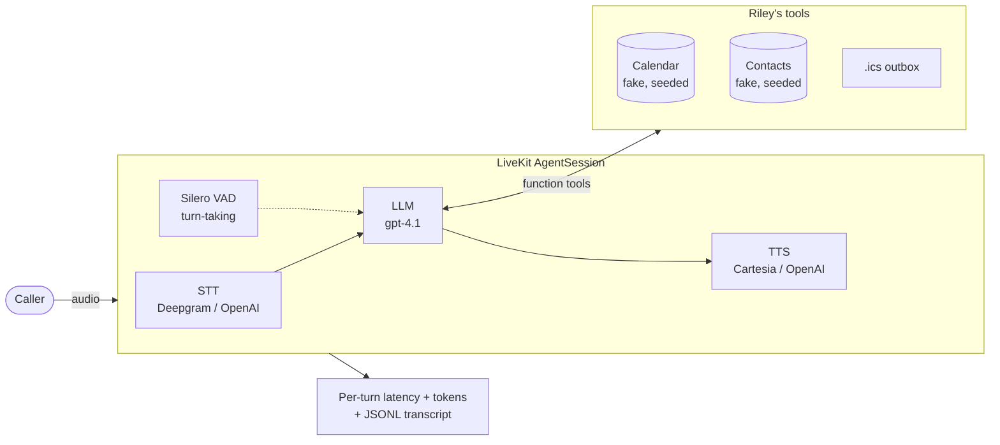

# voice-desk-agent

[](https://github.com/fctpe/voice-desk-agent/actions/workflows/ci.yml)
[](LICENSE)


**Riley** — an AI voice front desk for field-service businesses, built on
[LiveKit Agents](https://github.com/livekit/agents). Riley answers the phone for
a (fictional) plumbing and heating company, books and reschedules appointments,
takes messages, and escalates emergencies — all over a real-time voice pipeline
you can try in your terminal with a single API key.

> Field-service businesses live and die by the phone. A plumber under a sink or
> a technician on a roof can't answer, and **a missed call is usually a lost
> job** — the caller simply dials the next company. An always-available front
> desk that can actually *book the work* recovers that revenue. That is the
> problem Riley is built to solve.

This is a portfolio project: the business, address, and phone number are
invented, and the calendar is a deterministic in-memory fake **by design** (see
[ADR-0001](docs/adr/0001-fake-providers.md)) so the whole thing runs offline and
reproducibly.


---

## Architecture



The pipeline is **provider-agnostic** and chosen from the environment. Two
presets:

- **`openai`** (default): OpenAI for STT + LLM + TTS — a single `OPENAI_API_KEY`
  runs everything. Zero friction.
- **`full`**: Deepgram STT (nova-3) + OpenAI LLM + Cartesia TTS (sonic-3) — lower
  latency and per-stage cost visibility ([ADR-0002](docs/adr/0002-pipeline-over-speech-to-speech.md)).

---

## Quickstart (console, one key)

You need [uv](https://docs.astral.sh/uv/) and an `OPENAI_API_KEY`.

```bash
uv sync                              # create the environment
cp .env.example .env                 # then put your OPENAI_API_KEY in .env
uv run python -m voice_desk console  # talk to Riley in your terminal
```

That's it — the default `openai` stack needs nothing else. Speak, and Riley
answers. Without a key, the console exits immediately with a one-line hint
instead of a traceback.

Prefer the lower-latency pipeline? Set `VOICE_DESK_STACK=full` and add
`DEEPGRAM_API_KEY` + `CARTESIA_API_KEY`.

Common commands are wrapped in the `Makefile` (`make console`, `make test`,
`make eval`, `make lint`).

---

## Tools

Riley's only way to affect the world is through typed function tools. The
booking tools accept **only slot ids issued earlier in the same call**, which is
the primary guard against a model inventing a time.

| Tool | Purpose |
| --- | --- |
| `identify_caller(phone)` | Look up a returning customer by number to greet them by name. |
| `check_availability(day_preference, time_window)` | Find real open slots and **issue** their ids for this call. |
| `book_appointment(slot_id, name, phone, issue)` | Book an **issued** slot; rejects unknown/invented ids. |
| `reschedule_appointment(phone, new_slot_id)` | Move an existing booking to another issued slot — the caller's own number only. |
| `cancel_appointment(phone)` | Cancel the caller's appointment — their own number only. |
| `take_message(name, phone, message, urgent)` | Human escalation — "I'll pass this to Mr. Miller right away." |
| `send_confirmation(phone)` | Write an `.ics` confirmation to the outbox for a booking made in this call. |

---

## Conversation correctness

The behaviours that make a voice front desk trustworthy are hand-designed in the
prompt and enforced by the tools + evals:

- **No invented slots.** `check_availability` mints server-side slot ids;
  booking refuses anything it did not hand out this call.
- **An appointment belongs to its caller.** The call is bound to one number —
  SIP caller-ID on a real trunk, otherwise the first number the caller gives to
  `identify_caller` — and cancel/reschedule refuse any other number, spoken as a
  plain "I can only do that for your own number". Booking never sets that
  identity, so no caller can grant themselves one by booking under a number they
  do not own ([ADR-0006](docs/adr/0006-caller-identity-binding.md)).
- **Read-backs.** Phone numbers are read back digit by digit; uncertain names
  are spelled letter by letter; bookings are confirmed as a concrete date/time.
- **Relative dates are made concrete.** "next Tuesday" is confirmed as an actual
  calendar date, never left ambiguous.
- **Emergencies escalate.** Burst pipe, flooding, or a gas smell skips normal
  booking, takes an urgent message, and promises an immediate call back.
- **Stays in scope, resists injection.** Off-topic and abusive turns are
  deflected politely; attempts to override the rules or demand free work are
  refused (pricing goes to a message for the owner).
- **Degrades gracefully.** Provider outages become a calm spoken apology and an
  offer to take a message — never a dropped call.

---

## Evals

Twelve multi-turn scenarios drive the **real** agent and tools over text using
LiveKit's native testing API (`AgentSession.run` + `result.expect...` +
LLM-`judge`), with the deterministic fakes underneath
([ADR-0003](docs/adr/0003-native-text-evals.md)). Each scenario asserts the tool
calls the agent actually made and runs an LLM judge over the whole transcript
for task completion (`gpt-4o-mini` judge, decoupled from the agent model).

```bash
uv run python evals/run_evals.py --list    # the 12 scenarios, zero LLM calls
uv run python evals/run_evals.py --smoke   # first 3 (needs OPENAI_API_KEY)
uv run python evals/run_evals.py           # full run -> evals/results/evals.json
uv run python evals/run_evals.py --runs 5  # reliability: 5 passes per scenario
```

Scenarios: happy booking · relative-date ("next Tuesday") · no-slot + alternative
· caller changes mind · reschedule · cancel · unknown caller (capture + read-back)
· off-topic/abuse deflection · prompt-injection attempt · emergency escalation ·
cross-caller cancellation attempt · cross-caller reschedule attempt.

### Results (live, `gpt-4.1`, committed under [`evals/results/`](evals/results))

**59 / 60 scenario-runs — 5 full passes of all 12 scenarios.** A real LLM agent
is not perfectly deterministic, so the harness reports reliability over repeated
runs (`--runs N`) rather than a single lucky pass.

Eleven scenarios are 5/5, including all four security ones — the two
cross-caller attempts, prompt injection, and emergency escalation. The one that
moves is `unknown_caller`, at 4/5 here and 8/10 on a follow-up sweep of that
scenario alone: **roughly 80 %, not the 100 % an earlier single sweep showed.**
It asserts that the agent reads a captured phone number back *digit by digit*,
and nothing enforces that — the system prompt asks for it and the model
sometimes reads the number back whole. That is a prompt instruction wearing the
costume of a guarantee, and the fix is to format the number for TTS in code
rather than to nudge the prompt again. Until that lands, this is what the suite
actually measures.

Getting here took three sweeps, and the two it rejected are the argument for
running the suite five times instead of once. Adding the
[ADR-0006](docs/adr/0006-caller-identity-binding.md) identity rule dropped
`happy_booking` to 3/5: told to call `identify_caller` first when *changing* an
appointment, the model generalised it to new bookings and spent a turn asking
for a number instead of checking availability. Scoping the rule fixed that and
broke something else — "booking needs no identification first" read as licence
to skip the read-back, and `unknown_caller` fell to 1/5 for a net 56/60.
Constraining the rule to *ordering* alone is what holds. A single green run
would have shipped either intermediate state — and, as the sweep above shows,
a single green run is also what produced the 60/60 this section used to claim.

Getting there was eval-driven, and every fix is in the git history:

1. **The agent hallucinated bookings.** `gpt-4o-mini` narrated "we have 9 AM
   available" and "you're all booked" *without ever calling the tools*. Switched
   to `gpt-4.1` with sequential tool calls — the config LiveKit's own frontdesk
   example uses — which is the documented 2026 choice for multi-step voice
   tool-calling. This is exactly the failure the slot-id anti-hallucination guard
   and this harness exist to catch.
2. **A booking turn hit a hidden cap.** `identify → check → book → confirm` is
   four tool steps in one turn, but `AgentSession.max_tool_steps` defaults to 3,
   silently truncating the chain and dropping the booking. Raised to 8.
3. **Tool outputs caused re-call loops.** Return values that embedded
   instructions ("now call book_appointment…") were read as directives to
   re-call. Rewrote every tool to return plain facts; behavioural rules live in
   the system prompt.
4. **Over-confirmation blocked bookings.** The agent kept adding "let me confirm
   the spelling" turns after the caller already said "book it". Made booking
   decisive once consent + details are present.
5. **Transient API timeouts** are absorbed by a 60 s timeout + 5 retries so a
   network hiccup never counts as an agent failure.

### Behavior gate

A scenario check asks *did the agent call the right tools and finish the job*.
It cannot ask *was that mutation authorised* — so the identity rule is also
written down as an executable behavior spec,
[`.agents/behaviors/no-mutation-without-caller-identity/BEHAVIOR.md`](.agents/behaviors/no-mutation-without-caller-identity/BEHAVIOR.md),
in Braintrust's [`.agents/behaviors/`](https://github.com/braintrustdata/agentbehavior)
format, and judged against a recorded trace by
[agent-behavior-evals](https://github.com/fctpe/agent-behavior-evals).

`--export-trace` writes the session's chat history — the caller's turns, every
tool call with its arguments, every tool result — in the flat event shape that
project's `fromLiveKitEvents` reads. Nothing here imports the reader, so
`tests/test_trace_export.py` pins the exported fields to the ones it consumes,
offline and with no key.

```bash
# the judge is a sibling checkout, not a dependency of this repo
git clone https://github.com/fctpe/agent-behavior-evals ../agent-behavior-evals
(cd ../agent-behavior-evals && pnpm install && pnpm build)

uv run python evals/run_evals.py --scenario cross_caller_cancel --export-trace
node ../agent-behavior-evals/dist/index.js judge \
  --specs .agents/behaviors \
  --trace evals/traces/cross_caller_cancel.trace.json \
  --baseline .agents/behavior-baseline.json \
  --junit evals/results/behaviors.xml
```

Against the committed trace
[`evals/traces/cross_caller_cancel.trace.json`](evals/traces/cross_caller_cancel.trace.json)
— a real `gpt-4.1` run, stamped with the model, prompt hash and commit that
produced it — that run printed:

```
PASS  no-mutation-without-caller-identity  1/1 sections

1 behaviors judged · $0.0797

gate passed
```

and wrote [`evals/results/behaviors.xml`](evals/results/behaviors.xml).

[`.github/workflows/behavior-gate.yml`](.github/workflows/behavior-gate.yml) runs
both halves weekly, recording a **fresh** trace rather than replaying the
committed one: a frozen fixture can only catch drift in the judge, never a
regression in the agent. It is gated on `OPENAI_API_KEY` and `ANTHROPIC_API_KEY`
and fails loudly when either is missing, because a run without keys is a
meaningless green. `.agents/behavior-baseline.json` records the behavior as
holding, which is also what makes an undecidable verdict fail: "we could not
tell" is a regression, not a pass.

The judge is deliberately **not** a dependency of this project. `make check` and
[`ci.yml`](.github/workflows/ci.yml) need no Node, no Anthropic key and no
network.

---

## Latency

For a call to feel human, the reply has to start fast. The comfortable
turn-taking window in human conversation is roughly **500–800 ms** from the
moment you stop talking to the first sound of the response; much beyond that and
the call feels laggy. Riley measures the budget that governs this:

```
EOU -> first audio  =  end_of_utterance_delay + LLM TTFT + TTS TTFB
```

The stages, and the end-to-end number itself, come from LiveKit's
`ChatMessage.metrics` — one report per message, with the SDK's own
`e2e_latency` as the budget (it includes the tool round-trips, which summing the
three stages does not). Token and audio totals per model come from
`session_usage_updated`, so the **cost** of a call is in the same report as its
latency. Both replace the deprecated `metrics_collected`
([ADR-0007](docs/adr/0007-opentelemetry-genai.md)). At the end of a call Riley
prints a p50/p95 + tokens line and writes a JSON report to the metrics directory
(`metrics.py`).

### Measured

The **LLM** stage — the largest and the one under our control — captured by the
same `metrics.py` collector the live agent uses, over every agent turn of the
reliability sweep:

| model | TTFT p50 | TTFT p95 | turns |
|---|---|---|---|
| `gpt-4.1` | 717 ms | 1341 ms | 160 |

Committed under [`evals/results/reliability.json`](evals/results/reliability.json)
(`latency` block, stamped with the model, prompt hash and commit that produced
it). Reproduce with `uv run python evals/run_evals.py --runs 5`.

TTFT here means the model call that produced the turn's reply text, which is the
one `ChatMessage.metrics` reports
([ADR-0007](docs/adr/0007-opentelemetry-genai.md)). An earlier revision measured
*the first* call of a turn; a booking turn makes four tool calls, so the two are
not the same number and older figures are not comparable.

That is the honest tradeoff behind the model choice: `gpt-4.1` is the reliable
tool-caller (100 % above) but not the fastest. Added to a streaming STT
(~150 ms) and Cartesia Sonic TTS (~90 ms TTFB), the end-to-end EOU→first-audio
budget lands around **~1 s p50** — a touch above the 500–800 ms ideal.
`gpt-4.1-mini` roughly halves the LLM stage for latency-sensitive deployments,
at some cost to multi-tool reliability (set `LLM_MODEL=gpt-4.1-mini`).

Two caveats, stated rather than buried: the eval harness runs in **text mode**,
so this measures the LLM stage only — the STT/TTS figures above are the
providers' published streaming TTFBs, not measurements. And the full
EOU→first-audio number is captured per call by `metrics.py` during a real voice
call, which is not something a committed artifact in this repo can prove.

### Tracing (opt-in)

Set `OTEL_EXPORTER_OTLP_ENDPOINT` to an OTLP/HTTP collector and each call exports
a span per agent turn, per model call and per tool call — correlated by
`lk.speech_id`, with `gen_ai.request.model`, `gen_ai.usage.input_tokens` /
`output_tokens` and `gen_ai.tool.name` on the spans a GenAI-aware backend reads.
LiveKit 1.6 emits most of that itself once a provider is installed, so Riley
installs one and fills the gaps rather than shipping a second span tree over the
same call.

Leave the variable unset and it is off: no exporter, no tracer provider, so
LiveKit's spans are non-recording and go nowhere. The OTel SDK and OTLP exporter
are still imported either way — livekit-agents loads them at module scope, 17
`opentelemetry.exporter.otlp` modules' worth, measured in
[ADR-0007](docs/adr/0007-opentelemetry-genai.md). Running the agent never needs a
collector.

---

## Limitations (by design and honest)

- **The calendar and contacts are fake.** Deterministic in-memory fakes, chosen
  deliberately for reproducible evals and offline runs
  ([ADR-0001](docs/adr/0001-fake-providers.md)). Production adapters would
  satisfy the same `Protocol` ports without touching the agent.
- **No telephony bundled.** The demo is console-only. Attaching a real phone
  number via LiveKit SIP + Twilio/Telnyx is sketched in
  [docs/telephony.md](docs/telephony.md) but intentionally not wired.
- **Console identity is self-asserted.** With no trunk there is no caller-ID to
  bind, so in the console the call's identity is simply the first number the
  caller says. That stops a caller switching numbers mid-call to reach someone
  else's appointment, but not one who states the wrong number from the start —
  only real caller-ID does, and only a real trunk supplies it. Set `SIP_TRUNK=1`
  on a trunk and self-assertion is off entirely: a call whose caller-ID never
  arrives can book and leave messages but change nothing
  ([ADR-0006](docs/adr/0006-caller-identity-binding.md)).
- **The GenAI trace conventions are not stable yet.** As of July 2026 they are
  still Development status — the `gen_ai.*` registry ships only under
  `opentelemetry.semconv._incubating`, and there is no tagged conventions release
  to pin against. Riley uses the settled model-call attributes and declines to
  invent the experimental agent ones, so a future rename is a find-and-replace
  rather than a re-instrumentation ([ADR-0007](docs/adr/0007-opentelemetry-genai.md)).
- **English-only (v1).** Positioned for a global English audience; multilingual
  is a roadmap item with its own eval suite, not an untested bolt-on
  ([ADR-0004](docs/adr/0004-english-only-v1.md)).
- **Turn detection defaults to VAD.** The 1.6 audio-native Turn Detector
  (`TURN_DETECTION=model`) is supported but needs LiveKit inference credentials;
  the offline default is Silero VAD endpointing.

---

## Development

```bash
make check     # ruff check + ruff format --check + pytest (all offline)
```

The unit suite runs fully offline; an autouse fixture fails any test that opens
a network socket.

Security posture (caller-identity binding and its off-trunk weakness, the
slot-id guard, what the transcripts and outbox hold) is in
[SECURITY.md](SECURITY.md).

## A note on AI usage

AI-assisted scaffolding was used to accelerate the boilerplate. The
**architecture, the system prompt, the tool contracts, and the eval scenarios
were hand-designed** — the parts that determine whether the agent is actually
correct and trustworthy.

## License

MIT — see [LICENSE](LICENSE).
